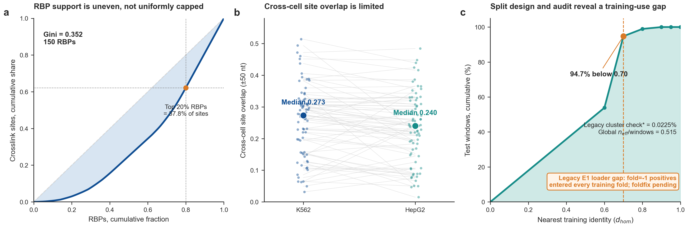
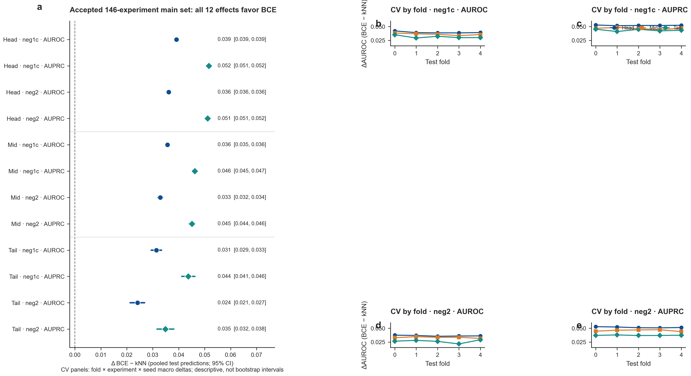
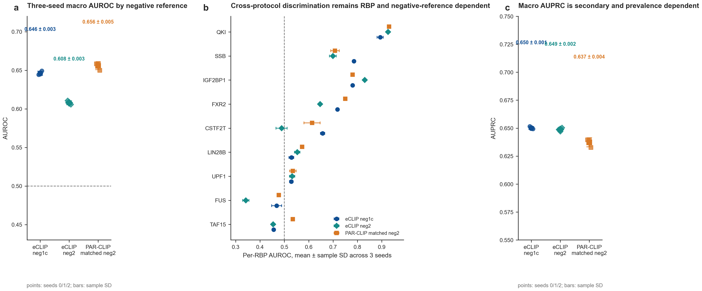
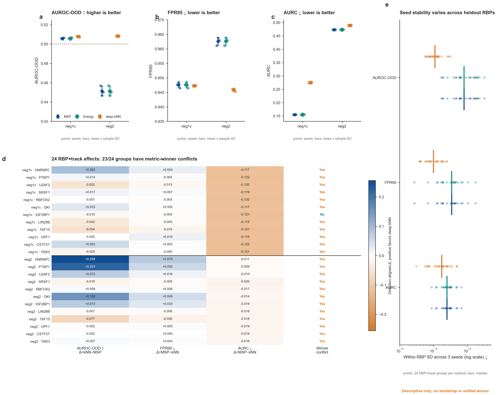
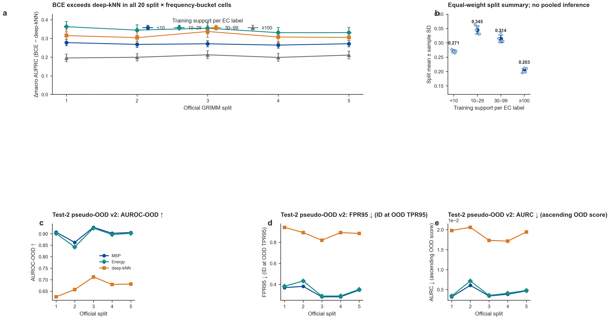

# Measurement Before Mechanism: Strict Evaluation Contracts for Long-Tailed Biological Sequence Prediction and Out-of-Distribution Rejection

**Preprint draft — single-column bioinformatics format**

## Abstract

Biological sequence benchmarks can conflate homology, constructed negatives, experimental protocol, and model inductive bias. We therefore evaluated measurement contracts before considering new mechanisms. In a descriptive fold-0 RNA-binding protein (RBP) probe, AUROC was 0.8901 under transcript-unmatched neg1c and 0.8188 under function-conditioned neg2. A separate loader audit found unassigned-fold positives entering historical training folds; all affected performance claims were withdrawn. Under the repaired strict3train contract, 146 eCLIP experiments were evaluated over five folds and three seeds. A frozen RNA-FM binary-cross-entropy head yielded higher AUROC and AUPRC than cluster-deduplicated cosine k-nearest neighbors in all 12 prespecified comparisons. Tail pooled AUROC/AUPRC differences were +0.031365/+0.043649 for neg1c and +0.024114/+0.034854 for neg2 (all percentile 95% confidence intervals excluded zero). This compares only two specified baselines. External PAR-CLIP discrimination varied markedly across RBPs and negative-reference constructions. In a separate pilot whole-RBP holdout, deep-kNN attained nearly random macro AUROC-OOD (0.507697 and 0.508286) and high FPR95 (0.947266 and 0.945827); its relative AUROC-OOD/FPR95 wins therefore did not constitute reliable rejection. AURC favored other scores, and winner ordering was metric-dependent in most RBP-by-track groups. Across five GRIMM protein splits, BCE-minus-deep-kNN macro AUPRC was positive in all 20 split-by-frequency cells and five overall aggregates. Test-2 pseudo-OOD remained descriptive and did not establish unknown-EC discovery. These results support strict contracts, bounded baseline comparisons, and explicit operating-point reporting rather than a unified mechanism or universal rejection score.

**Keywords:** RNA-binding proteins; biological sequence models; long-tailed learning; data leakage; out-of-distribution detection; evaluation contracts

## Introduction

Long-tailed labels and distribution shift are central problems in biological sequence prediction. They are also measurement problems. A predictor may obtain a high score by separating positives from compositionally mismatched negatives, by exploiting sequence redundancy, or by learning protocol-specific associations rather than condition-specific molecular function. Conversely, a weak out-of-distribution (OOD) ranking does not imply that every selective-prediction operating point is useless. The order in which these possibilities are tested determines which scientific conclusions are justified.

Large-scale enhanced crosslinking and immunoprecipitation (eCLIP) resources have enabled systematic modeling of RNA-binding protein (RBP) specificity [@vannostrand2020large]. A recent benchmark further showed that negative construction materially changes protein–RNA interaction prediction [@horlacher2023systematic]. Foundation models provide transferable sequence representations [@chen2022rnafm; @hayes2025simulating], but representation quality alone does not identify the source of a benchmark advantage. Homology-aware splitting, explicit negative definitions, validation-only selection, and operating-point-aware OOD evaluation must therefore be treated as parts of the model comparison itself.

This study begins with process deviations rather than a proposed architecture. First, an implementation artifact in negative exclusion and compositional differences between negative tracks motivated a controlled comparison of negative definitions. Second, an independent loader audit revealed that positives without a fold assignment had entered every historical cross-validation training fold. That observation invalidated the affected legacy performance claims and led to a strict3train contract: exactly three explicitly assigned folds are used for training, one for validation, and one for testing. Third, only after this contract was independently accepted did we compare frozen-representation neural and retrieval baselines across frequency strata.

The remaining questions follow from what those comparisons cannot resolve. A closed-set advantage does not establish stable mapping across experimental protocols, so fixed eCLIP-trained heads were evaluated on external PAR-CLIP positives under three separately reported negative references. Unstable cross-protocol discrimination does not establish useful rejection, so whole-RBP holdouts were evaluated using AUROC-OOD, the false-positive rate at 95% OOD sensitivity (FPR95), and area under the risk–coverage curve (AURC). Finally, neither RNA classification nor RNA rejection establishes a cross-modal rule; five protein splits were used to test the boundaries of both observations.

The contributions are empirical and methodological:

- a documented data and training-contract audit with two explicitly separated negative tracks, with legacy results excluded rather than silently reused;
- bounded RNA and protein comparisons of frozen-representation BCE heads against the specified cosine-neighbor baselines across frequency strata;
- cross-protocol and OOD analyses that preserve descriptive, pilot, and pseudo-OOD evidence labels and expose differences between ranking and operating-point metrics.

The paper does not claim superiority over a comprehensive model matrix, a validated proxy-function mechanism, or universal OOD rejection.

## Related Work

### RBP benchmarks and sequence representations

ENCODE eCLIP provides condition-resolved RBP binding measurements across hundreds of experiments [@vannostrand2020large]. Horlacher et al. systematically compared machine-learning methods for protein–RNA interaction prediction and demonstrated the importance of benchmark construction [@horlacher2023systematic]. Our RNA data processing follows that benchmark's crosslink-window convention, but adds an explicit audit of negative exclusion, fold assignment, and training-loader behavior. PAR-CLIP supplies an independent experimental protocol rather than an interchangeable replicate of eCLIP [@mukherjee2019deciphering].

RNA-FM learns general representations from unannotated non-coding RNA and has been evaluated on several structure and function tasks [@chen2022rnafm]. RiNALMo subsequently scaled RNA language modeling and reported improved generalization on structure-prediction tasks [@penic2025rinalmo]. Parameter-efficient adaptation such as low-rank adaptation (LoRA) offers an alternative to frozen probes and full fine-tuning [@hu2022lora]. The present accepted RNA matrix is deliberately narrower: it compares a frozen RNA-FM neural head with cluster-deduplicated cosine k-nearest neighbors (kNN). RiNALMo, LoRA, and full fine-tuning remain outside the accepted result set.

Protein language models similarly provide general-purpose representations; ESM Cambrian includes the ESMC-300M encoder used here [@hayes2025simulating]. GRIMM introduces genetic stratification and paired closed-/open-set enzyme-function tests [@babjac2026grimm]. RNAcompete provides in-vitro binding specificities [@ray2013compendium], while CAFA3 provides time-staged community evaluation of protein-function annotation [@zhou2019cafa]. Both are relevant external model matrices, but neither is treated as a completed experiment in this draft.

### OOD scores and selective prediction

Maximum softmax probability (MSP) is a simple confidence baseline [@hendrycks2017baseline], energy scores provide an alternative logit-based ranking [@liu2020energy], and deep nearest-neighbor distance uses representation-space proximity for OOD detection [@sun2022deepknn]. Selective classification separately asks how classification risk changes as low-confidence examples are rejected [@geifman2017selective]. These objectives are related but not interchangeable: AUROC-OOD measures ranking, FPR95 measures a particular rejection operating point, and AURC depends on the errors accumulated as coverage expands. We therefore report all three rather than selecting a single favorable summary.

## Methods

### Study design and evidence labels

The analysis is organized by inferential question, not by execution chronology. Table 1 defines the four accepted evaluation universes. Throughout, *main* refers to the 146-experiment strict3train RNA matrix, *external descriptive* to the nine-RBP PAR-CLIP analysis, *pilot descriptive* to the fold-0 whole-RBP OOD analysis, and *five-split* to the protein experiments. Three training seeds quantify computational repeatability; they are not independent biological replicates.

**Table 1. Accepted datasets, roles, and inferential scope.**

| Dataset and task | Train/test roles and split policy | Encoder and compared heads/scores | Seeds | Statistical unit and aggregation | Evidence level |
|---|---|---|---:|---|---|
| 146 eCLIP experiments; binary RBP binding | Three explicit id90-component folds for training, one for validation, one for testing; strict3train; neg1c/neg2 | Frozen RNA-FM 640-D; BCE MLP versus cluster-deduplicated cosine kNN | 3 | Five-fold predictions pooled within experiment; paired window bootstrap; experiment macro averages | Main M-test; only the two prespecified baselines |
| Nine-RBP PAR-CLIP external discrimination | eCLIP folds 2/3/4 train, fold 1 validation; PAR-CLIP external positives; eCLIP fold-0 or matched PAR-CLIP negative references | Fixed frozen-RNA-FM BCE heads | 3 | Nine-RBP macro average within seed, then seed mean/sample SD | External descriptive; no significance test or OOD claim |
| Twelve whole-RBP holdouts; pilot OOD | Assigned folds only; each held-out RBP excluded from train, validation, and known test; pilot fold 0 | Frozen-RNA-FM BCE; MSP, energy, and deep-kNN | 3 | Twelve-RBP macro average within track and seed, then seed mean/sample SD | Pilot descriptive; 72/72 pairs; no OOD bootstrap |
| GRIMM EC_v2; multilabel classification and pseudo-OOD | Five official splits; Test-1 classification and Test-2 pseudo-OOD | Frozen ESMC-300M 960-D; linear BCE versus deep-kNN; MSP/energy seed ensembles | 3 | Within-split EC-label bootstrap for classification; equal-split descriptive summaries | Five-split test; only AUROC-OOD has existing paired intervals; Test-2 is pseudo-OOD |

### RNA positives, windows, and homology-aware folds

The frozen eCLIP source set contains 223 experiments, 150 RBPs, and 73 RBPs measured in both K562 and HepG2. The main set comprises those 73 paired RBPs, yielding 146 experiments. Peak processing follows the source benchmark: replicate peaks are intersected with transcript regions, reciprocal 50% same-strand intersections are combined by union, peaks are filtered by SMInput fold change of at least two and capped at 20,000, and the peak 5′ base defines the crosslink. Each example is a strand-oriented 101-nucleotide window spanning ±50 nucleotides around the crosslink; non-ACGU windows are skipped. Genome coordinates use the GRCh38 primary assembly and GENCODE v42 BASIC annotation [@frankish2023gencode].

Positive windows were clustered at 90% nucleotide identity using CD-HIT-EST [@li2006cdhit]. Clusters were linked through annotated regions and nearby cross-region connections, and connected components were assigned as units to five folds (split seed 20261122). The main positive set contains 2,168,739 windows and 1,117,660 clusters. Among 2,147,319 fold-assigned windows in the nearest-neighbor audit, 94.7403% had closest training-positive identity below 0.7. This quantity describes sequence similarity under the frozen split; it is not a claim of zero leakage or absence of pretraining contamination.

### Negative tracks and process audit

Two negative tracks define separate evaluation tasks. **neg1c** samples windows from the BASIC sampling frame with a fixed seed, matches the positive count, and correctly excludes ±300-nucleotide neighborhoods around target-RBP positive sites. **neg2** uses other RBPs' observed sites, excludes sites from the same RBP in either cell line and any one-base-pair overlap with the target positives, and samples with replacement at a 1:1 ratio. These tracks differ in both negative population and class-conditional composition; differences between them are not causal estimates of a negative-sampling intervention.

A third track, **neg1f**, is retained only for implementation auditing. It reproduces the original subtract operation, which was empirically a no-op. A mean 1.82% of neg1f windows fell within the positive ±300-nucleotide exclusion neighborhood. The main composition audit gave positive-minus-negative U-fraction differences of −0.041 for neg1c and −0.007 for neg2, and GC-fraction differences of +0.088 and +0.010, respectively. A frozen logistic-regression probe on main fold 0 was used only as a descriptive difficulty check.

The loader audit separately identified 21,420 of 2,168,739 positive windows (0.9877%) with `fold=-1`. The historical Boolean loader retained these windows in each training fold. All performance claims depending on that loader were withdrawn from the current evidence set. The repaired `e0-v2-id90-strict3train-main` contract selects exactly three explicit training folds, leaves `(f+1) mod 5` for validation and fold `f` for testing, and admits no `fold=-1` example into training. Validation and test assignments remain those of the frozen split. This correction and the accompanying convergence change were accepted together; no causal attribution to either change alone is made.



**Figure 1 | Data support, cross-cell concordance, and the repaired RNA data contract.** Panels summarize RBP support, site concordance between cell lines, and nearest-training homology. The current strict3train contract excludes unassigned-fold examples from training and was independently accepted for all 146 experiments. The historical 0.0225% cluster check included validation in its nominal training set and double-counted positives across tracks; it is not a strict3train leakage rate. Source runs: `E0-leakage-quant-20261122-102238-ZDLg6Y`, `E0-window-identity-20261122-104517-ZDLg6Y`, `E1-main-independent-audit-20261126-032635-ZDLg6Y`, and `E1-main-independent-recalculation-20261126-105611-ZDLg6Y`.

### Frozen RNA baselines and statistical comparison

RNA-FM parameters were frozen, and masked-mean 640-dimensional embeddings were used for both baseline families. The neural head was a 256-hidden-unit multilayer perceptron trained with binary cross entropy (BCE), AdamW [@loshchilov2019adamw], and label smoothing of 0.02. Checkpoint selection used validation AUPRC independently for each task, with patience 20 and minimum improvement `1e-4`; 1000 epochs was only a failsafe. The best checkpoint was restored.

For retrieval, one representative per frozen id90 cluster was retained among training positives, while negatives were unchanged. Cosine kNN used `k ∈ {5, 10, 20}`, selected by validation macro AUPRC on tail RBPs; all main fold-by-track selections chose `k=20`. Repeated neg2 windows were preserved and aligned using experiment, fold, track, window identity, label, and occurrence.

Head, middle, and tail strata contained 100, 28, and 18 experiments, respectively. AUROC and AUPRC were reported separately. For the primary comparison, five-fold test predictions were pooled within each experiment, windows were resampled pairwise 10,000 times, metrics were averaged over three seeds, and differences were macro-averaged over experiments. Percentile 95% confidence intervals and two-sided sign-test probabilities with finite-sample correction were computed for BCE minus kNN. With 10,000 resamples, `p=0.00019998` is the minimum attainable finite-sample-corrected value, not a precisely resolved tail probability. A separate low-homology descriptive slice retained test positives with `d_hom<0.60` and all corresponding test negatives. No bootstrap was performed for that slice, and its changed class prior prevents direct AUPRC comparison with the full closed set.

### Fixed-head PAR-CLIP evaluation

Nine RBPs overlapped the eCLIP main set and the PAR-CLIP hg38 v2 data: CSTF2T, FUS, FXR2, IGF2BP1, LIN28B, QKI, SSB, TAF15, and UPF1. The external set contained 520,896 positive windows. For each RBP and training track, eCLIP folds 2/3/4 were used for training and fold 1 for validation. Fold 0 supplied only eCLIP reference negatives; its eCLIP positives were not used. PAR-CLIP examples did not participate in training, checkpoint selection, hyperparameter selection, or sample selection.

Three evaluations were kept separate: PAR-CLIP positives against eCLIP fold-0 neg1c; the same positives against eCLIP fold-0 neg2; and a same-protocol neg2 slice in which other RBPs' PAR-CLIP sites were matched within uniquely annotated genes, excluded around target sites by ±300 nucleotides, deduplicated as candidates, and sampled with replacement. The last slice reduces protocol mismatch but does not provide known non-binding sites. AUROC was primary. AUPRC was secondary because positive priors, matching coverage, and repeated samples differ across evaluations. Metrics were macro-averaged over nine RBPs within each seed, followed by the mean and sample standard deviation across seeds.

### Whole-RBP holdout and OOD operating points

The RNA OOD experiment is a distinct pilot protocol, not an extension of the strict3train main matrix. Twelve RBPs were each entirely excluded from training, validation, and known testing and used only as held-out tests. Training used assigned folds only. The frozen RNA-FM BCE head was selected by known-validation tail pooled AUPRC with the same patience-20 rule. For each of 12 RBPs, two negative tracks, and three seeds, MSP, energy, and deep-kNN were evaluated, producing 72 RBP-by-track-by-seed pairs and 216 method rows.

All OOD scores increase with unfamiliarity. For binary probability `p` and logit `z`, MSP was `-max(p, 1-p)` and energy was `-abs(z)`. Deep-kNN used negative maximum cosine similarity to at most 50,000 stably subsampled training embeddings. AUROC-OOD treats known examples as negative and held-out examples as positive. FPR95 is the fraction of known examples called OOD at the 5th-percentile OOD-score threshold, corresponding to 95% OOD sensitivity. AURC integrates classification error as examples are accepted in ascending OOD-score order; it is therefore not a pure OOD-separability measure. Within each seed and track, metrics were macro-averaged over 12 RBPs, then summarized by the mean and sample standard deviation over seeds. No OOD bootstrap or significance test was performed.

### Protein classification and pseudo-OOD

GRIMM EC_v2 is a multilabel enzyme-commission prediction benchmark with five official splits [@babjac2026grimm]. ESMC-300M parameters were frozen, and real amino-acid positions were mean-pooled into 960-dimensional embeddings. A linear BCE head was trained for three seeds per split. Validation macro AUPRC over labels with training support below 100 controlled early stopping, selection of `τ ∈ {0, 0.5, 1}`, and Fmax threshold selection. Deep-kNN used `k=20`.

Test-1 macro AUPRC differences were computed for training-frequency buckets `<10`, `10–29`, `30–99`, and `≥100`. Within each split and bucket, EC labels were resampled pairwise 10,000 times. Cross-split means, sample standard deviations, ranges, and direction counts are descriptive; labels and proteins were not pooled across splits and no cross-split significance test was constructed.

Test-2 is **pseudo-OOD**, not a demonstration of discovering genuinely unknown EC functions. Some of its labels occur in training, and GRIMM isolation is per EC label rather than global UniRef50 exclusivity. MSP and energy used three-seed ensemble scores, whereas deep-kNN was deterministic. OOD v2 defined FPR95 as the in-distribution false-positive rate at 95% OOD sensitivity and AURC as the accumulated OOD proportion among samples accepted in ascending OOD-score order. The saved score arrays were reanalyzed offline without retraining. Existing paired intervals cover AUROC-OOD; no new per-seed or bootstrap intervals were introduced for FPR95 or AURC.

## Results

### Negative construction and loader behavior changed the measurement problem

The descriptive frozen probe obtained AUROC 0.8901 on neg1c and 0.8188 on neg2, a decrease of 0.0713 on main fold 0 (`E0-frozen-probe-20261122-100702-ZDLg6Y`). This is a single-fold measurement, not a five-fold effect estimate. The much smaller composition differences in neg2 show why the two tracks should not be interpreted as interchangeable measurements of the same task. The neg1f exclusion artifact affected only a limited neighborhood fraction and does not explain the full neg1c-to-neg2 difference. Conversely, these observations do not identify a unique biological cause: residual composition, transcript coverage, protocol batch, and pretraining exposure remain possible explanations.

The unassigned-fold loader channel was a separate process failure, not a hyperparameter choice. The accepted strict3train matrix removed that channel and independently verified training identities, fold counts, prediction occurrence alignment, explicit CUDA execution, checkpoint histories, and finite outputs (Fig. 1). Historical main, pilot, fine-tuning, routing, and positive-unlabeled results from the affected chain are not used to support any result below.

### Strict3train favored frozen RNA-FM BCE over cluster-deduplicated cosine kNN

In the main set of 146 eCLIP experiments, the repaired strict3train contract used five folds and three seeds to compare the frozen RNA-FM BCE head with cluster-deduplicated cosine kNN. In the prespecified prediction-pooled window bootstrap, all 12 BCE-minus-kNN effects were positive and their percentile 95% confidence intervals excluded zero (Table 2; Fig. 2). The finite-sample-corrected two-sided `p=0.00019998` is the minimum attainable value with 10,000 resamples. In the tail, pooled ΔAUROC was +0.031365 for neg1c and +0.024114 for neg2; corresponding ΔAUPRC values were +0.043649 and +0.034854. Positive effects were not restricted to the tail: head and middle strata also favored BCE. These results argue against treating universal retrieval superiority as a rule for this task, but they compare only the two specified baselines and do not rank other backbones, fine-tuning methods, or model families.

**Table 2. Strict3train main-set paired bootstrap effects (BCE minus cluster-deduplicated cosine kNN).**

| Track | Stratum | Metric | Difference | Percentile 95% CI | Two-sided p |
|---|---|---|---:|---:|---:|
| neg1c | Tail | AUROC | +0.031365 | [0.029428, 0.033362] | 0.00019998 |
| neg1c | Tail | AUPRC | +0.043649 | [0.041139, 0.046228] | 0.00019998 |
| neg1c | Middle | AUROC | +0.035647 | [0.034915, 0.036366] | 0.00019998 |
| neg1c | Middle | AUPRC | +0.046167 | [0.045193, 0.047131] | 0.00019998 |
| neg1c | Head | AUROC | +0.039102 | [0.038837, 0.039363] | 0.00019998 |
| neg1c | Head | AUPRC | +0.051634 | [0.051269, 0.051988] | 0.00019998 |
| neg2 | Tail | AUROC | +0.024114 | [0.021317, 0.026865] | 0.00019998 |
| neg2 | Tail | AUPRC | +0.034854 | [0.031653, 0.038104] | 0.00019998 |
| neg2 | Middle | AUROC | +0.032881 | [0.031925, 0.033836] | 0.00019998 |
| neg2 | Middle | AUPRC | +0.045078 | [0.043893, 0.046283] | 0.00019998 |
| neg2 | Head | AUROC | +0.036123 | [0.035800, 0.036436] | 0.00019998 |
| neg2 | Head | AUPRC | +0.051136 | [0.050699, 0.051579] | 0.00019998 |

The descriptive low-homology slice showed the same direction. For neg1c, BCE/kNN AUROC was 0.875332/0.830752 (Δ=+0.044580) and AUPRC was 0.781584/0.697716 (Δ=+0.083869). For neg2, AUROC was 0.790567/0.751782 (Δ=+0.038785) and AUPRC was 0.653712/0.585196 (Δ=+0.068516). These values are three-seed descriptive averages without a low-homology bootstrap; they do not establish homology as the causal source of the baseline difference.



**Figure 2 | Accepted strict3train RNA baseline comparison.** Forest plots show the 12 prediction-pooled paired bootstrap effects; fold-wise curves are descriptive and use a different estimand. Head/middle/tail contain 100/28/18 experiments. All 60 fold-by-track-by-stratum-by-metric descriptive CV differences were positive, but these fold-wise directions do not replace the bootstrap. Runs: `E1-cv-prediction-combine-20261126-064253-ZDLg6Y`, `E1-cv-summary-20261126-065042-ZDLg6Y`, `E1-paired-bootstrap-20261126-065044-ZDLg6Y`, and `E1-main-independent-recalculation-20261126-105611-ZDLg6Y`.

### Cross-protocol mapping was heterogeneous across RBPs and negative references

In the external descriptive evaluation limited to nine overlapping RBPs, fixed eCLIP heads were selected only by eCLIP validation and then applied to PAR-CLIP positives under three separate negative references. Three-seed macro AUROCs were 0.646192±0.002641 with eCLIP neg1c, 0.607869±0.002595 with eCLIP neg2, and 0.655701±0.004951 with gene-matched PAR-CLIP neg2 (Table 3; Fig. 3). The other-RBP PAR-CLIP sites are operational negatives, not verified non-binding sites. Differences between negative references are not model improvements or protocol-corrected causal effects because negative populations, gene coverage, sample sizes, and repetition structures differ.

**Table 3. External PAR-CLIP descriptive performance (mean ± sample SD over three seeds).**

| Negative reference | AUROC | AUPRC (secondary) |
|---|---:|---:|
| eCLIP fold-0 neg1c | 0.646192 ± 0.002641 | 0.650157 ± 0.001232 |
| eCLIP fold-0 neg2 | 0.607869 ± 0.002595 | 0.648735 ± 0.001567 |
| PAR-CLIP other-RBP, gene-matched, ±300 nt excluded | 0.655701 ± 0.004951 | 0.637280 ± 0.004010 |

Macro stability across seeds concealed substantial per-RBP heterogeneity. For example, QKI AUROC was 0.893460±0.012476, 0.926055±0.005546, and 0.929810±0.005163 across the three references, whereas FUS was 0.468185±0.020339, 0.341448±0.013067, and 0.477222±0.007267. TAF15 remained near chance (0.455823±0.005796, 0.454111±0.006835, and 0.534622±0.004568). AUPRC requires additional caution: eCLIP positive priors varied widely, and the matched PAR-CLIP sample's nominal 1:1 ratio contains replacement duplicates and coverage filtering.

The results therefore do not support a stable, universal eCLIP-to-PAR-CLIP functional mapping. They also do not measure OOD rejection: no rejection threshold or risk–coverage operating point was defined in this external classification experiment.



**Figure 3 | Fixed-head cross-protocol evaluation on nine RBPs.** Panels show macro AUROC, per-RBP AUROC, and secondary macro AUPRC under three negative references. Error bars are sample standard deviations over three computational seeds, not biological-replicate confidence intervals. PAR-CLIP did not participate in training or selection. Runs: `E5-parclip-cross-protocol-contract-p20-20261125-065228-ZDLg6Y`, `E5-parclip-cross-protocol-contract-p20-20261125-065619-ZDLg6Y`, and `E5-parclip-cross-protocol-contract-p20-20261125-065953-ZDLg6Y`.

### RNA OOD rankings were metric-dependent and did not support reliable rejection

In the pilot fold-0 whole-RBP evaluation, 12 held-out RBPs, two tracks, and three computational seeds formed 72/72 descriptive RBP-by-track-by-seed pairs. Deep-kNN attained macro AUROC-OOD of only 0.507697 on neg1c and 0.508286 on neg2, while FPR95 was 0.947266 and 0.945827 (Table 4; Fig. 5). Thus, at 95% OOD sensitivity, approximately 94.6%–94.7% of known examples were still called OOD. Although deep-kNN ranked best among the three candidates on macro AUROC-OOD and FPR95, this absolute performance does not support practical or reliable rejection. AURC instead favored energy on neg1c (0.155127) and MSP on neg2 (0.473079). Thus, the method preferred for OOD ranking and a 95%-sensitivity operating point was not the method preferred for selective classification risk.

**Table 4. Pilot whole-RBP OOD results (macro mean ± sample SD over three seeds).**

| Track | Method | AUROC-OOD ↑ | FPR95 ↓ | AURC ↓ |
|---|---|---:|---:|---:|
| neg1c | MSP | 0.505720 ± 0.000757 | 0.947533 ± 0.001007 | 0.155127 ± 0.000530 |
| neg1c | energy | 0.505720 ± 0.000757 | 0.947533 ± 0.001007 | 0.155127 ± 0.000530 |
| neg1c | deep-kNN | **0.507697 ± 0.000455** | **0.947266 ± 0.000052** | 0.274965 ± 0.000812 |
| neg2 | MSP | 0.451279 ± 0.005128 | 0.962582 ± 0.001344 | **0.473079 ± 0.000558** |
| neg2 | energy | 0.451279 ± 0.005128 | 0.962582 ± 0.001344 | 0.473079 ± 0.000558 |
| neg2 | deep-kNN | **0.508286 ± 0.000128** | **0.945827 ± 0.000493** | 0.489085 ± 0.000372 |

The frozen winner rule yielded a nominal 23/24 RBP-by-track groups with conflicting metric winners, but this count is sensitive to ties and floating-point tails. MSP and energy are monotone transformations of absolute logit for a binary sigmoid classifier and were therefore treated as one binary-confidence family for interpretation. In particular, SRSF1/neg2 and TAF15/neg2 had exactly equal MSP and energy FPR95 values within each of the three seeds; their nominal MSP/energy winner switches do not constitute substantive three-method conflicts. The robust interpretation is therefore that winner ordering was metric-dependent in most RBP-by-track groups, not that 23/24 groups demonstrate distinct rejection mechanisms. AURC also depends on classification errors rather than measuring pure OOD separability: MSP/energy had AUROC-OOD below 0.5 on neg2 despite lower AURC, and these directions cannot be merged into a single OOD-performance ordering. Track differences combine negative definitions with different class priors and are not causal effects. The high FPR95 values and worse deep-kNN AURC are a negative result for reliable unified rejection, not evidence that every held-out RBP lacks any ranking signal. These pilot fold-0 results have no OOD bootstrap, and their seed standard deviations are not biological confidence intervals.



**Figure 5 | Whole-RBP holdout exposes OOD metric and operating-point conflicts.** Panels summarize 72 accepted pairs, 24 RBP-by-track effects, and per-RBP seed variability. All scores increase with OOD status; the three metrics are not combined. Nominal winner counts are interpreted with MSP/energy treated as an equivalent binary-confidence family because floating-point tie-breaking is not mechanistic evidence. Summary run: `E5-holdout-convergence-summary-20261126-112101-ZDLg6Y`; the accepted package contains 216 method rows, no missing pairs, and 48 cross-seed alignment checks.

### Protein results delimited both frequency and rejection conclusions

Across five official GRIMM EC_v2 splits, a frozen ESMC-300M linear BCE head was trained under the unified validation-convergence protocol and compared with deterministic deep-kNN. BCE-minus-deep-kNN macro AUPRC was positive in all 20 split-by-frequency cells, and every within-split EC-label bootstrap 95% CI excluded zero (Fig. 4). The five additional All-label overall aggregates were also positive with intervals excluding zero; these are summary rows, not independent frequency tests. The equal-split descriptive differences were largest for the 10–29 bucket (+0.344729±0.014232) and smallest for ≥100 (+0.203189±0.007761), but this ordering is not a monotonic or causal frequency law (Table 5). Cross-split summaries remain descriptive and do not create pooled significance evidence.

**Table 5. Protein Test-1 BCE-minus-deep-kNN macro AUPRC across five official splits.**

| Training-frequency bucket | Split mean ± sample SD | Split range | Positive cells | Within-split CI excludes zero |
|---|---:|---:|---:|---:|
| <10 | +0.270534 ± 0.004936 | [+0.264211, +0.277586] | 5/5 | 5/5 |
| 10–29 | +0.344729 ± 0.014232 | [+0.330767, +0.362792] | 5/5 | 5/5 |
| 30–99 | +0.313893 ± 0.013636 | [+0.304232, +0.337079] | 5/5 | 5/5 |
| ≥100 | +0.203189 ± 0.007761 | [+0.195413, +0.212319] | 5/5 | 5/5 |
| All labels (aggregate) | +0.278050 ± 0.005618 | [+0.271014, +0.284777] | 5/5 | 5/5 |

On Test-2 pseudo-OOD, MSP and energy showed more favorable descriptive directions than deep-kNN on AUROC-OOD, FPR95, and AURC in all five splits (Table 6). This ranking differed from the RNA whole-RBP result but does not establish a cross-modal mechanism. MSP and energy used three-seed ensembles, whereas deep-kNN was deterministic; the comparison therefore combines scoring rules with aggregation choices and cannot identify an intrinsic confidence-versus-distance effect. Even MSP had mean FPR95 of 0.330908, ranging from 0.280241 to 0.380164 across splits. These seed-ensemble pseudo-OOD observations lack new per-seed FPR95/AURC intervals, do not establish per-seed stability, and do not demonstrate discovery of unknown EC functions. Their AURC measures accumulated OOD proportion among accepted samples, whereas RNA AURC accumulates classification errors, so absolute values should not be equated.

**Table 6. Protein Test-2 pseudo-OOD v2 descriptive summaries across five splits.**

| Method | AUROC-OOD ↑ | FPR95 ↓ | AURC ↓ |
|---|---:|---:|---:|
| MSP | 0.900729 ± 0.023814 | 0.330908 ± 0.047589 | 0.004241 ± 0.001172 |
| energy | 0.893031 ± 0.030502 | 0.348061 ± 0.061738 | 0.004603 ± 0.001536 |
| deep-kNN | 0.671086 ± 0.032101 | 0.887120 ± 0.044059 | 0.018860 ± 0.001546 |

The protein results extend the baseline observation across frequency buckets but simultaneously reject a universal cross-modal rejection ranking. They do not establish a shared RNA–protein mechanism.



**Figure 4 | Protein frequency-stratified classification and pseudo-OOD v2.** Test-1 panels show within-split EC-label bootstrap intervals and equal-split descriptive summaries. Test-2 pseudo-OOD panels show AUROC-OOD, FPR95, and AURC separately. Runs: five accepted training runs listed in Reproducibility, `E6-ood-metric-recompute-v2-20261125-072246-ZDLg6Y`, `E6-five-split-summary-20261125-080318-ZDLg6Y`, and `E6-five-split-independent-verification-20261125-080348-ZDLg6Y`.

## Discussion

The central finding is not that one model family universally dominates another. It is that defensible comparisons depend on a sequence of exclusions. Negative construction first changed task difficulty; a loader audit then showed why an apparently reasonable split design was insufficient without checking the realized training identities. Only after repairing that contract did the 12 RNA baseline effects become interpretable. This reasoning does not rely on the order in which experiments happened to be executed.

The strict3train result is narrower and more useful than a generic “deep learning beats retrieval” conclusion. A frozen RNA-FM BCE head outperformed one carefully specified cluster-deduplicated cosine kNN baseline across all frequency strata and both negative tracks. The comparison shows that retrieval is not automatically the strongest low-frequency baseline. It does not compare a comprehensive model matrix, show that all retrieval implementations are inferior, or establish that representation similarity explains function.

Cross-protocol performance introduced a different failure mode. Stable macro averages across three seeds coexisted with near-chance results for individual RBPs and strong dependence on the negative reference. Same-protocol negative construction is therefore necessary but insufficient: other RBPs' PAR-CLIP sites may be unobserved target sites, gene matching changes coverage, and replacement sampling changes effective sample size. A single cross-protocol AUROC cannot summarize functional transfer.

The RNA OOD experiment further separates discrimination from decision-making. Deep-kNN's nominal AUROC-OOD/FPR95 wins did not yield reliable rejection, and AURC preferred another score. Reporting only the best metric would have concealed this conflict. Treating MSP and energy as an equivalent binary-confidence family also makes the nominal 23/24 winner count tie-sensitive; the defensible conclusion is metric-dependent ordering in most groups, not a census of distinct mechanisms. Protein Test-2 pseudo-OOD produced a different descriptive ordering, but its distinct task construction, risk event, and score aggregation preclude a unified cross-modal interpretation.

The stopped method line is a scope decision, not a hidden positive result. The M1a shared-residual proposal failed its validation-only stop gate under a legacy data chain. It is therefore excluded from the main results; M1b–M1f were not run, and no claim is made that residual mechanisms are either generally effective or generally ineffective. Likewise, historical routing and positive-unlabeled experiments are not revived by the repaired strict3train baseline matrix. The accepted evidence supports benchmark discipline and negative OOD findings, not a validated proxy-function-gap mechanism.

## Limitations

The accepted RNA model matrix is limited to frozen RNA-FM BCE and cluster-deduplicated cosine kNN. RiNALMo, LoRA, and full fine-tuning matrices are ongoing and have no accepted results here. RNAcompete and CAFA3 model matrices are also ongoing; their data and protocols do not contribute performance numbers to this manuscript. No conclusion about those models or datasets is implied.

All seed-based variability describes computational repetition, not independent biological replication. The PAR-CLIP analysis is external and descriptive, while the whole-RBP OOD analysis is a pilot fold-0 descriptive study without bootstrap inference. Protein cross-split summaries are equally weighted descriptions, not pooled five-replicate tests.

Negative labels remain imperfect. neg2 sites can include unobserved target-RBP binding events, and replacement sampling retains duplicates. AUPRC comparisons across tracks or filtered slices are sensitive to class priors. eCLIP and PAR-CLIP differ in protocol, cellular environment, transcript coverage, and sampling frame; the matched PAR-CLIP negative slice reduces only part of this confounding.

Pretraining contamination cannot be excluded for RNA-FM or ESMC-300M. The id90 split controls realized training-fold assignment, not the foundation model's pretraining exposure. Low-homology stratification is descriptive and does not identify homology as a causal mechanism.

GRIMM Test-2 is pseudo-OOD: 304 of its 694 split-1 labels also occur in training, and per-label clustering does not imply global sequence-cluster exclusivity. Duplicate sequences, truncation, annotation transfer, and pretraining exposure remain relevant. Protein FPR95/AURC lack new per-seed intervals, and neither protein nor RNA results demonstrate prospective discovery of unknown functions.

Finally, AURC has task-specific semantics. RNA AURC includes classification errors, whereas the protein pseudo-OOD implementation accumulates OOD proportion. Cross-modal numerical comparison of AURC would therefore be inappropriate even without the other limitations.

## Conclusion

Strict evaluation contracts changed which conclusions could be defended. After negative-construction artifacts and an unassigned-fold training channel were addressed, the frozen RNA-FM BCE head consistently yielded higher AUROC and AUPRC than cluster-deduplicated cosine kNN across RNA frequency strata. That advantage did not entail stable cross-protocol mapping, reliable whole-RBP rejection, or a universal protein ordering. The strongest current contribution is therefore a reproducible evaluation framework with explicit evidence tiers, strong but bounded baselines, and joint reporting of OOD ranking and operating-point metrics. Future model comparisons should preserve these contracts rather than use them as a narrative for an unvalidated mechanism.

## Reproducibility and Data Availability

The repository is [Cunyu-Liu/proxy-function-gap](https://github.com/Cunyu-Liu/proxy-function-gap). It contains analysis code, accepted small aggregate artifacts, verification reports, and the five current figures. Large embeddings, checkpoints, and per-window arrays are not claimed to be included in the repository snapshot. Source datasets and annotations are available from the [RBP benchmark](https://github.com/mhorlacher/Benchmark-RBP), [GENCODE release 42](https://www.gencodegenes.org/human/release_42.html), and [GRIMM](https://huggingface.co/datasets/HoarfrostLab/GRIMM); original publications are cited above.

The accepted figure set is under `figures/`, with machine-readable numeric and rendering audits under `figures/verification/`. Figures can be regenerated from the repository root with:

```bash
python3 -m py_compile code_rareseq/paper_figures.py
python3 code_rareseq/paper_figures.py --figure all --contact-sheet
```

**Accepted run ledger.** Aggregate runs identify the exact evidence packages used in this draft; they do not imply that legacy runs were reaccepted.

| Evidence | Accepted run identifiers |
|---|---|
| RNA process audit | `E0-leakage-quant-20261122-102238-ZDLg6Y`; `E0-window-identity-20261122-104517-ZDLg6Y`; `E0-frozen-probe-20261122-100702-ZDLg6Y` |
| strict3train audit and aggregation | `E1-main-independent-audit-20261126-032635-ZDLg6Y`; `E1-cv-prediction-combine-20261126-064253-ZDLg6Y`; `E1-cv-summary-20261126-065042-ZDLg6Y`; `E1-paired-bootstrap-20261126-065044-ZDLg6Y`; `E1-stratified-analysis-20261126-104609-ZDLg6Y`; `E1-main-independent-recalculation-20261126-105611-ZDLg6Y` |
| PAR-CLIP patience 20 | `E5-parclip-cross-protocol-contract-p20-20261125-065228-ZDLg6Y`; `E5-parclip-cross-protocol-contract-p20-20261125-065619-ZDLg6Y`; `E5-parclip-cross-protocol-contract-p20-20261125-065953-ZDLg6Y` |
| Whole-RBP OOD | `E5-holdout-convergence-summary-20261126-112101-ZDLg6Y` |
| Protein split 1–5 training | `E6-grimm-frozen-baselines-20261124-085329-ZDLg6Y`; `E6-grimm-frozen-baselines-20261124-070400-ZDLg6Y`; `E6-grimm-frozen-baselines-20261124-104344-ZDLg6Y`; `E6-grimm-frozen-baselines-20261124-123513-ZDLg6Y`; `E6-grimm-frozen-baselines-20261124-171811-ZDLg6Y` |
| Protein aggregation and OOD v2 | `E6-ood-metric-recompute-v2-20261125-072246-ZDLg6Y`; `E6-five-split-summary-20261125-080318-ZDLg6Y`; `E6-five-split-independent-verification-20261125-080348-ZDLg6Y` |

The primary verification files are `E1_强基线/results/strict3train_p20_v2/verification/final_verification.json`, `E5_OOD/results/holdout_convergence_final_summary/verification.json`, `E5_OOD/results/holdout_convergence_final_summary/independent_verification.json`, and `E6_蛋白迁移/results/five_split_agg/independent_verification.json`. The PAR-CLIP small-table verification snapshot is under `figures/data/parclip_p20/`. Legacy results remain in audit history only and are not inputs to the current figures.

## References

References are supplied in `references.bib` and use the citation keys embedded in this Markdown draft.
